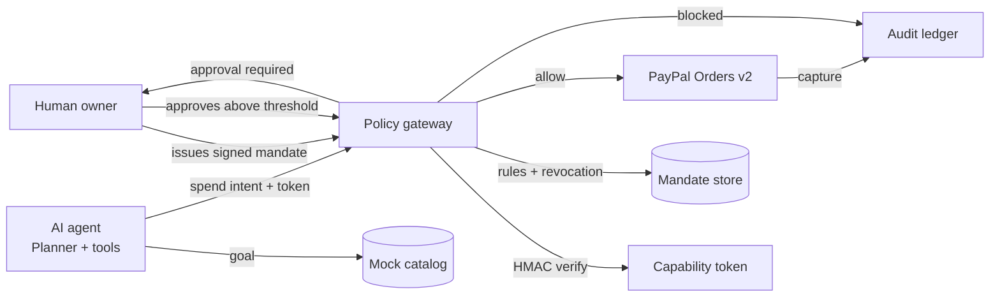

# Mandate

**Spend authority for autonomous agents.**

Mandate lets a human hand an AI agent a scoped, signed, revocable budget — and then lets the agent actually pay with PayPal inside those rails.

Built for the **PayPal AI Hackathon: Build what's next with PayPal and AI** (Agentic Commerce track).

---

## The problem

2026 is the year agents started buying things. The blocker is not intelligence — it is authority.

You cannot hand an autonomous agent your card number. You need to answer questions a card cannot:

- What is it allowed to buy?
- From whom?
- How much, per purchase and in total?
- When must it stop and ask me?
- How do I cut it off *right now*?

Mandate is the missing layer between an agent and a payment method: a **capability token with a policy engine and a human-in-the-loop**.

## What it does

A human issues a mandate:

```json
{
  "agent": "Scout",
  "budget": 400.00,
  "per_txn_cap": 150.00,
  "approval_threshold": 100.00,
  "merchants": ["stride.run", "runnersdepot.com"],
  "categories": ["footwear"],
  "expires_at": "in 24 hours"
}
```

The agent receives a **signed token** carrying those limits. On every spend it must present the token to the gateway, which:

1. **Verifies the HMAC-SHA256 signature** — the agent cannot edit its own limits.
2. **Runs the policy engine** — status, expiry, merchant allowlist, category, per-transaction cap, remaining budget, velocity.
3. **Checks the human approval threshold** — anything above it becomes a pending request the owner approves or denies.
4. **Captures payment through PayPal Orders v2** — sandbox by default, mock when no credentials are configured.
5. **Writes an auditable ledger** — every check, every decision, every order ID.

Revocation is server-side and instant. The token stays cryptographically valid; the gateway simply refuses it.

## Why it is agentic commerce

This is not a shopping chatbot. It is the **authorization primitive** that makes agent-initiated payments safe:

- Agents can transact autonomously inside explicit, machine-readable limits.
- Humans keep veto power at exactly the moment that matters (above threshold).
- Every decision is explainable, which is what merchants, issuers, and regulators will require.
- The same model generalizes to subscriptions, payouts, procurement, and API metering.

## Quick start

No dependencies. Python 3.10+ standard library only.

```bash
python3 app.py
```

Open **http://127.0.0.1:3000**.

The app starts in **mock payment / heuristic planner** mode, so every flow works with zero configuration. The UI labels the mode in the header.

### Optional: real PayPal sandbox payments

Create an app at <https://developer.paypal.com/dashboard/applications/sandbox>, then:

```bash
cp .env.example .env
# fill in PAYPAL_CLIENT_ID and PAYPAL_CLIENT_SECRET
python3 app.py
```

The header badge changes to `PayPal · sandbox`, and orders are created and captured with the live Orders v2 API against `api-m.sandbox.paypal.com`.

Verify credentials in one command:

```bash
python3 scripts/check_setup.py
```

### Optional: model-driven planning

Mandate works with any OpenAI-compatible chat endpoint:

```bash
LLM_API_KEY=...            # enables the LLM planner
LLM_BASE_URL=https://api.openai.com/v1
LLM_MODEL=gpt-4o-mini
```

Without a key, a transparent heuristic planner produces the same structured plan. The policy engine — the part that must be deterministic — never depends on the model.

Run `python3 scripts/check_setup.py` to confirm which modes are active. It never prints secrets.

## Demo: three acts

Open the app and use the **Demo** buttons in the agent console.

| Act | Goal | What it proves |
|---|---|---|
| **① Inside the rails** | “Find me running shoes for under $100.” | Planning → search → policy → PayPal capture, fully autonomous. |
| **② Hit the wall** | “Get me the cheapest Aero Tempo 4 you can find.” | The cheapest listing is on a marketplace that is **not** on the allowlist, so the agent skips it. The next listing is above the **$100 approval threshold**, so the agent stops and asks the human. Approve it to complete the purchase. |
| **③ Pull the plug** | Revoke, then “Buy the Trail Blaze 2.” | The token still verifies, but the revocation check blocks the spend. No charge. |

Also in the mandate panel:

- **Verify signature** — shows the token is intact.
- **Tamper test** — rewrites `budget` to `$99,999`, keeps the old signature, and the gateway rejects it.
- **Top up +$75** — re-issues a fresh signed token. The agent never touches the signing key.

A shot-by-shot video plan lives in [`docs/demo-script.md`](docs/demo-script.md).

## Architecture



```
app.py                 HTTP server, routes, static files
mandate/
  config.py            env + persistent signing key
  crypto.py            HMAC-SHA256 capability tokens
  policy.py            pure policy engine (fully unit-tested)
  catalog.py           mock storefront
  ai.py                LLM planner + heuristic fallback
  paypal.py            Orders v2 client + mock
  store.py             JSON persistence, revocation, approvals
  agent.py             planning loop, policy checks, payment
public/                zero-build UI (HTML/CSS/JS)
tests/                 policy, token, and PayPal integration tests
scripts/               setup check + GitHub publish helper
docs/demo-script.md    three-minute video plan
PUBLISH.md             GitHub publishing steps
data/                  runtime state (gitignored)
```

## Security model

| Threat | Control | Where |
|---|---|---|
| Agent edits its own limit | HMAC-SHA256 signed token; gateway verifies every spend | `mandate/crypto.py`, `mandate/agent.py` |
| Agent spends after owner cancels | Server-side revocation status checked independently of the token | `mandate/policy.py`, `mandate/store.py` |
| Agent buys from a hostile merchant | Merchant allowlist | `mandate/policy.py` |
| Agent exceeds a budget | Per-transaction cap + remaining budget + velocity limit | `mandate/policy.py` |
| Agent makes an unwanted large purchase | Human approval threshold; re-checked again at capture time | `mandate/agent.py` |
| Payment provider error | Failed transaction recorded, no spend counted | `mandate/agent.py` |

The signing key is generated once under `data/.secret` for the demo. In production it belongs in a KMS and never on the application host.

## API

| Method | Path | Purpose |
|---|---|---|
| `GET` | `/api/state` | Mandate, ledger, approvals, actions, mode |
| `GET` | `/api/catalog` | Mock storefront |
| `POST` | `/api/mandates` | Issue a mandate |
| `POST` | `/api/mandates/:id/revoke` | Revoke instantly |
| `POST` | `/api/mandates/:id/topup` | Raise budget, re-issue token |
| `POST` | `/api/agent/run` | `{ goal, mandate_id?, token_override? }` |
| `POST` | `/api/approvals/:id/approve` | Human approval → capture |
| `POST` | `/api/approvals/:id/deny` | Human denial |
| `POST` | `/api/verify` | Verify any token |
| `POST` | `/api/webhooks/paypal` | Webhook receiver with signature verification |
| `POST` | `/api/reset` | Reset the demo |

## Tests

```bash
python3 -m unittest discover -s tests -t . -v
```

20 tests cover every policy rail (allow, approval, blocked merchant, category, cap, budget, expiry, revocation, velocity), the token layer (round-trip, wrong key, tampered payload, malformed input), and the PayPal Orders v2 client against a local stub server (OAuth, order creation, capture, headers, payload shape, token caching, error handling).

## What is real, what is mocked

- **Real:** policy engine, signed tokens, revocation, approval workflow, ledger, PayPal Orders v2 integration, webhook verification.
- **Mock:** the storefront catalog, and payments when no PayPal credentials are configured (clearly labelled `MOCK` everywhere).

Swapping the mock catalog for a real merchant is a single data source — the gateway contract does not change.

## Roadmap

- Vault a funding instrument per mandate, so the agent never sees payment details.
- Merchant-side SDK: accept `mandate_token` at checkout.
- Delegation: an agent issues a narrower sub-mandate to a specialist agent.
- Spend analytics and exportable audit packs for finance teams.
- Per-category and per-time-window budgets.

## License

MIT — see [LICENSE](LICENSE).
